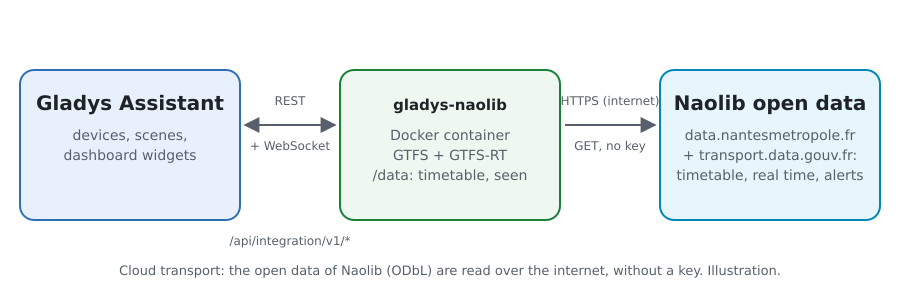
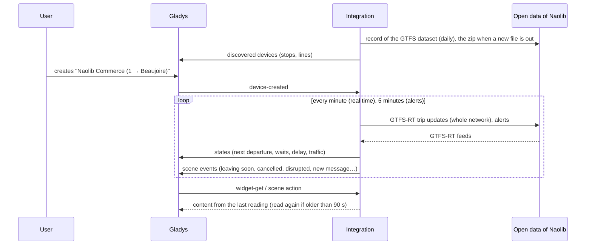
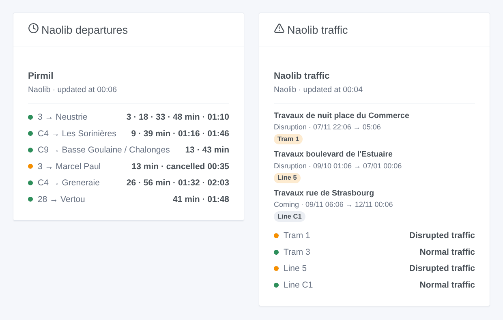

# Gladys Naolib Nantes

**English** · [Français](README.fr.md) · [Deutsch](README.de.md) · [Español](README.es.md)

[](LICENSE)
[](https://github.com/William-De71/gladys-naolib/releases)
[](https://github.com/William-De71/gladys-naolib/actions/workflows/release.yml)
[](https://gladysassistant.com)


[Gladys Assistant](https://gladysassistant.com) external integration for **Naolib**, the trams, busways, buses and Navibus of Nantes: the next departures at your stops, corrected in real time, with their delay and the cancelled trips, and the traffic of your lines, with scenes and dashboard widgets. It reads the official open data of Naolib (GTFS and GTFS-RT), without an account or a key.

User documentation: [English](docs/en.md) · [Français](docs/fr.md) · [Deutsch](docs/de.md) · [Español](docs/es.md).

> Community integration, not affiliated with nor endorsed by Naolib or Nantes Métropole.

## Features

- **One device per followed stop** (three in the form, up to 10 more with the **Add a stop** button), typed by name, and filtered by **line** and **direction**: next departure, wait of the next two departures, delay of the next one.
- **One device per followed line** (up to six), trams, busways, Chronobus, buses and Navibus: its traffic state (normal, traffic information, disrupted, heavily disrupted) from the alerts of Naolib, and the messages under way.
- **Real time**: the estimated time and the delay once its trip is under way, the timetable otherwise (marked as such), the cancelled trips and the stops not served.
- **5 scene triggers**, **2 scene actions** and **2 dashboard widgets** (below).
- **One request for every followed stop**: the real time of the whole network every minute by default (30 s to 5 min, every 10 min at night when nothing is announced), the alerts every 5 minutes, the timetable once a day only when it changed (kept in `/data`).
- Configuration buttons: test the connection, find a stop (codes, lines), add / remove / list stops, diagnostic.
- Four languages everywhere: English, French, German, Spanish.

## How it works



```mermaid
flowchart LR
  G[Gladys Assistant] <-->|REST /api/integration/v1/* + WebSocket| I[gladys-naolib container]
  I -->|HTTPS, no key| A[data.nantesmetropole.fr (GTFS)<br/>proxy.transport.data.gouv.fr (GTFS-RT)]
  I --- D[(/data<br/>timetable zip, lines, stops, events seen)]
```

At start, the integration reads the record of the GTFS dataset on `data.nantesmetropole.fr`, downloads the timetable it points to (a 19 MB zip) and keeps it in `/data`; the next days it reads the record again and downloads the zip only when a new file was published (its id changed). It reads the lines (`routes.txt`) and gathers the platforms of one stop place into a stop (`stops.txt`: "Commerce" holds the platforms of every tram and bus; a name used in two towns, "Poitou", makes `poitou` and `poitou-2`). It then resolves what you typed: "tram 1" is the line `1`, "commerce" the stop Commerce. From the zip it extracts the departures of the followed stops over eight days (`trips.txt` and `stop_times.txt`, 408 MB once inflated, are streamed, never held in memory: a reading peaks at about 155 MB and takes 10 to 20 seconds). On its own timer it reads the trip updates of the whole network (GTFS-RT through `proxy.transport.data.gouv.fr`, one request whatever the number of stops) and corrects each departure of its trip with the estimate of the platform; every 5 minutes it reads the alerts. The source behind the proxy answers once every 30 seconds: a refused reading is asked again a few seconds later, and a reading of less than 3 minutes stands in for it. Each reading is compared with the previous one to fire the scene triggers.



### Transport

Cloud only (`"transports": ["cloud"]`): the catalog shows the cloud badge. The integration contacts `data.nantesmetropole.fr` + `proxy.transport.data.gouv.fr`. There is no local alternative, so there is no "prefer the local connection" button.

## Devices and features

| Device             | Feature                      | Category / type              | Values                                               |
| ------------------ | ---------------------------- | ---------------------------- | ---------------------------------------------------- |
| Naolib \<stop\>    | Next passage                 | `text` / `text`              | "1 → Beaujoire · 3 min (+2 min late)"                |
| Naolib \<stop\>    | Wait, wait for the following | `duration` / `integer`       | 0 … 180 min                                          |
| Naolib \<stop\>    | Delay of the next passage    | `duration` / `integer`       | 0 … 120 min                                          |
| Naolib tram / line | Traffic                      | `text` / `text`              | "Disrupted traffic: Travaux boulevard de l'Estuaire" |
| Naolib tram / line | Traffic messages under way   | `counter-sensor` / `integer` | 0 … 20                                               |

Without any departure in the next three hours, the stop shows the first departure of the morning; the delay is published only for a departure followed in real time.

## Scene triggers, actions and widgets



**Scene triggers** (once per transition; the first reading is a reference and fires nothing):

- **Departure soon**: a departure at a followed stop leaves in 2, 3, 5, 10, 15 or 20 minutes, on its real-time estimate. Filters: stop, minutes.
- **Departure cancelled**: a trip of the next hour at a followed stop is cancelled or does not serve it. Filter: stop.
- **Line disrupted**: a followed line becomes disrupted or heavily disrupted. Filter: line.
- **Back to normal**: no disruption under way on the line any more. Filter: line.
- **New traffic message**: Naolib publishes an alert about a followed line, under way or coming. Filters: line, kind (information, disruption, heavy disruption).

**Scene actions**: **next departures** of a stop (line, destination, wait, time, real time or not, delay, the following one, a sentence) and **traffic of a line** (state, messages, latest message, a sentence).

**Widgets**: **Naolib departures** (a followed stop, several in one list, or any stop typed in the settings) and **Naolib traffic** (the followed lines, the ones typed, or the three tram lines by default).

Examples:

- When **tram 1 towards Beaujoire leaves Commerce in 5 minutes** → light the hall lamp in green.
- When **a departure of your stop is cancelled** or **the C1 is diverted** → send `{{triggerEvent.data.summary}}` to your phone.
- Every weekday at 7:30 → **read the next departures** of your stop and have the `summary` spoken by the kitchen speaker.

## Requirements

- Gladys Assistant **5.3.0** or later (widgets and scene triggers of external integrations, catalog keywords and countries of Gladys 5.3). Older instances cannot install the integration.
- Nothing else: the open data of Naolib need neither an account nor a key.

## Installation

- **From the store** of Gladys (Integrations → External integrations), in one click, once indexed.
- **From the repository URL**: `https://github.com/William-De71/gladys-naolib`.
- **Developer mode**: build the image locally (`docker build -t gladys-naolib .`) and install it from Gladys.

## Configuration

| Field                    | Description                                                                  |
| ------------------------ | ---------------------------------------------------------------------------- |
| Stop (1 to 3)            | A name as written on the stop: "Commerce", "Gare Nord - Jardin des Plantes". |
| Line                     | "1", "C1", "4", "N1". Empty: every line of the stop.                         |
| Direction                | Words of the destination: "Beaujoire", "Beaujoire \| Ranzay". Empty: both.   |
| Followed lines           | Up to six, separated by commas: "1, 2, C1, 4".                               |
| Reading of the real time | 30 s, 1 min (default), 2 min or 5 min.                                       |
| Language of the texts    | Device names, scene summaries and outputs.                                   |

Buttons: **Test the connection**, **Find a stop** (code and lines of each stop found), **Add a stop**, **Remove a stop**, **List the stops** (the stops beyond the three of the form, kept in the Gladys configuration) and **Diagnostic** (writes the stops, lines, timetable kept, last departures, errors and requests to the Logs tab).

## Usage

1. Enter one to three stops — more with **Add a stop** — (with their line and direction if you wish) and the lines to follow, then save.
2. In the **Discover** tab, create the "Naolib …" devices.
3. Add the **Naolib departures** and **Naolib traffic** widgets to a dashboard, and build scenes with the triggers above.

## Development

```bash
npm install
npm test                       # node --test, never touches the network
npm run lint && npm run format:check
npx github:GladysAssistant/integration-store . --skip-image-check
scripts/build-cover.sh         # cover.jpg from docs/assets/cover.svg
docs/illustrations/render.sh   # docs/assets/widgets.<lang>.png
node .github/scripts/release.mjs next
```

Locally, the SDK reads `GLADYS_HOST_API_URL`, `GLADYS_INTEGRATION_TOKEN` and `GLADYS_INTEGRATION_SELECTOR`; `NAOLIB_API_URL` points the integration to another feeds root (a mock); `DEBUG=gladys-integration-sdk` shows the SDK logs and checks every widget content. The tests use real open data of Naolib, reduced (`test/fixtures/`, ODbL): the zip is built and the feeds encoded by `test/helpers/fixtures.js`. The rules of the project are in [CLAUDE.md](CLAUDE.md).

## Release process


Every merge on `main` runs the CI, then computes the version from the [Conventional Commits](https://www.conventionalcommits.org/) since the last tag: `feat` → minor, `fix` / `perf` → patch, `!` or `BREAKING CHANGE` → major (a minor below 1.0.0); `docs`, `chore`, `ci`, `test`, `style`, `refactor`, `build` alone publish nothing. The changelog section is generated, the tag pushed, the multi-architecture image built, then `main` receives the release commit, the GitHub Release is created and a last job checks the public image, the store validator and the topic.

- The pull request title becomes the squash commit, then the changelog line: write it in English, for the user (`pr-title.yml` checks it). Never edit `CHANGELOG.md` by hand.
- 1.0.0 is a decision: Actions → Release → Run workflow with `release-as: 1.0.0`. `dry-run` shows the version and the notes without publishing.
- **Protected branch**: the release pushes its commit to `main` with `GITHUB_TOKEN`. With a ruleset on `main` stricter than "no deletion, no force-push", add GitHub Actions to its bypass list (or push through a GitHub App), otherwise the publish job fails with instructions.
- After the first release, make the `ghcr.io` package public (Package settings → Change visibility), or Gladys cannot pull it.

## Troubleshooting

See [docs/en.md](docs/en.md#troubleshooting). Report issues with the versions of Gladys and of the integration, the stop or line concerned, and the lines of the **Diagnostic** button.

## Contributing

Issues and pull requests are welcome. Run `npm run format:check && npm run lint && npm test` before opening a pull request, and keep every external id and stored key unchanged (see [CLAUDE.md](CLAUDE.md)).

## Security

See [SECURITY.md](SECURITY.md): report vulnerabilities privately. The integration needs no secret: it only reads public open data, and runs read-only, as a non-root user, in its container.

## Screenshots to come

The images above are illustrations, not screenshots. Real screenshots will go in `docs/assets/screenshots/` (PNG, 1280 × 800): `configuration.png`, `discovery.png`, `device.png`, `scene.png`.

## License

[Apache License 2.0](LICENSE) — see also [NOTICE](NOTICE). The timetable, the real time and the alerts are open data of Naolib (Nantes Métropole) under the [Open Database License (ODbL)](https://opendatacommons.org/licenses/odbl/1-0/): the widgets show the source and the time of each reading. Thanks to the Gladys documentation and SDK, and to Nantes Métropole for publishing these data in real time.
