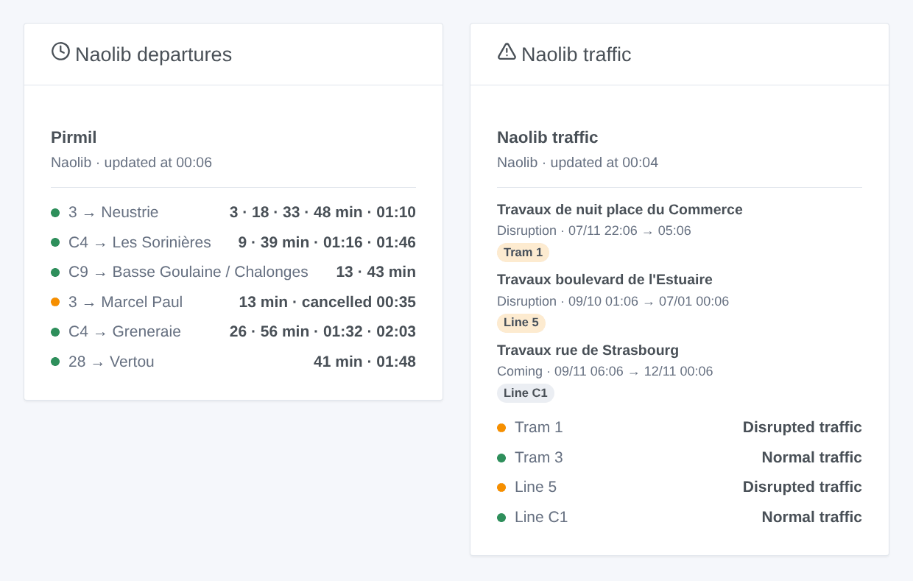

# Naolib Nantes

## Overview

This integration brings **Naolib**, the trams, busways, Chronobus, buses and Navibus of Nantes Métropole, into Gladys. It gives the **next departures, corrected in real time, with their delay**, at the stops you choose (three in the form, up to 10 more with a button), filtered by line and direction. It also follows the **traffic** of up to six lines (normal, traffic information, disrupted, heavily disrupted), with the alerts of Naolib: diversions, stops moved, works. Each stop and each line becomes a device to show on a dashboard and to use in scenes.

The data come from the **official open data of Naolib** (Nantes Métropole), under the ODbL licence: no account, no key. The **timetable** (GTFS, published on `data.nantesmetropole.fr`) is downloaded only when a new file is published, and kept by the integration. The **real time** (GTFS-RT) of the whole network is read through `transport.data.gouv.fr`, the national access point, in **one request for every followed stop**, every minute by default (every 10 minutes while no stop announces anything in the next half hour, at night). The alerts are read every 5 minutes.

A departure is **followed in real time** once its trip is under way: its estimated time and its delay are given. Before that it is the **timetable**, marked "(timetable)". **Cancelled trips** and **stops not served** are shown.

The source of the real time answers once every 30 seconds for everyone: when it is busy, the integration asks again a few seconds later and, meanwhile, uses its last reading (less than 3 minutes old).

This is a **cloud** integration: it contacts `data.nantesmetropole.fr` and `proxy.transport.data.gouv.fr`. Nothing else leaves your network.

## Requirements

- Gladys Assistant 5.3.0 or later.
- Nothing else: the open data of Naolib need no account and no key.

## Configuration

| Field                    | What to type                                                                                               |
| ------------------------ | ---------------------------------------------------------------------------------------------------------- |
| Stop 1, 2, 3             | The name of the stop as written on it: "Commerce", "Gare Nord - Jardin des Plantes".                       |
| Line                     | Only this line: "1", "C1", "4", "N1". Empty: every line of the stop.                                       |
| Direction                | Only the destinations holding these words: "Beaujoire", "Beaujoire \| Ranzay". Empty: both directions.     |
| Followed lines           | The lines whose traffic you follow, six at most: "1, 2, C1, 4".                                            |
| Reading of the real time | Every 30 seconds, minute, 2 minutes or 5 minutes.                                                          |
| Language of the texts    | Names of the devices, summaries and outputs of the scenes. Stop names and traffic messages stay in French. |

A stop gathers every platform of its stop place, trams and buses: "Commerce" gives both directions of the trams 1, 2 and 3 and the buses calling there. A name used in two towns ("Poitou") gives two stops: the second one is written with "-2" by **Find a stop**. The **Find a stop** button gives the stops holding a few words, with their lines ("Commerce → 1, 2, 3…"). A few words are enough when only one stop holds them ("haluch" → Haluchère - Batignolles). **Test the connection** asks for the timetable again and reads each stop and each line right away.

A line is written as on the vehicle: "1" to "3" for the trams, "4" and "5" for the busways, "C1" to "C20" for the Chronobus, "N1" to "N3" for the Navibus, "26", "NS" (Nuit Sud)…

More stops than the three of the form (home, work, school…): **Add a stop** takes the same three fields — stop, line, direction — and follows up to 10 more stops. **List the stops** shows every followed stop, numbered; **Remove a stop** takes that number (or the name). The added stops are kept in the configuration of Gladys, so they follow its backups.

The timetable of Naolib is a big file: the first reading, and the one of each new file, takes some 20 seconds.

## Usage

### Devices

In the **Discover** tab, create the devices you want:

- **Naolib \<stop\>**: the next departure as text ("1 → Beaujoire · 3 min (+2 min late)"), the wait of the next departure and of the one after (minutes), and the delay of the next one (minutes, published only when it is followed in real time);
- **Naolib tram 1**, **Naolib line C1**…: the traffic as text ("Disrupted traffic: Travaux boulevard de l'Estuaire") and the number of traffic messages under way.

At night, without any departure in the next three hours, the device shows the first departure of the morning.

### Traffic

Naolib publishes **alerts**: a text, the lines (or the stops) concerned and their periods. The state of a line comes from its heaviest alert under way: **heavily disrupted** for an interruption, **disrupted** for a diversion, stops moved or not served, delays, **traffic information** otherwise; **normal** without an alert. An alert starting in the next three days is shown as coming. The link to the map of a diversion, when given, opens from the card of the alert.

### Dashboard widgets

- **Naolib departures**: the next departures of a stop, compact. One row per line and destination, with its next departures in a row ("2 · 17 min"). A cancelled trip is shown ("cancelled 22:48") and turns the row orange, like a delay of 5 minutes or more. The **Routes shown** setting sets the number of rows. Choose a followed stop, or type any stop (and a line) in the widget settings. With **Several stops**, one widget shows several stop devices: the devices of one stop are merged under its name; for different stops, each stop opens with a row of its own.
- **Naolib traffic**: the state of each line, then the alerts under way and those of the next three days, with their period. Tap a card for the full text. The followed lines, the ones typed in the settings, or the three tram lines when you follow none.

### Scenes

Triggers, once per change (the first reading is only a baseline):

- **Naolib: departure soon**: a departure at a followed stop leaves in 2, 3, 5, 10, 15 or 20 minutes, counted on its real-time estimate.
- **Naolib: departure cancelled**: a trip of the next hour at a followed stop is cancelled, or does not serve the stop.
- **Naolib: line disrupted**: a followed line becomes disrupted or heavily disrupted.
- **Naolib: back to normal**: no disruption under way on the line any more.
- **Naolib: new traffic message**: Naolib publishes an alert about a followed line, under way or coming.

Each gives a ready-made sentence, `{{triggerEvent.data.summary}}`, and its values (line, destination, time, delay, title, text, start and end…). The actions **Naolib: next departures** and **Naolib: traffic of a line** return the same kind of values, to put in a message or to test in a condition.

Examples:

- When tram 1 towards Beaujoire leaves Commerce in 5 minutes → turn the hall lamp green.
- When a departure of your stop is cancelled, or the C1 is diverted → send the summary to your phone before you leave.
- Every weekday at 7:30 → read the next departures of your stop and have the kitchen speaker announce them.

### Transport

Cloud only: the data come from the internet. The timetable when a new file is published, the real time of the whole network in one request, the alerts every 5 minutes.

## Troubleshooting

- **"Unknown or ambiguous"**: use **Find a stop**, then copy the exact name (with its "-2" for the second stop of a name); for a line, its name as on the vehicle ("1", "C1", "4").
- **"(timetable)" after a departure**: its trip is not under way yet, or Naolib does not follow it; the time is the one of the timetable.
- **No departure in the direction typed**: the destinations are the ones written on the vehicles ("Beaujoire", "François Mitterrand"); empty the direction to see them all.
- **"The open data of Naolib do not answer"**: the integration tries again at each reading; meanwhile the departures come from the timetable kept. A short refusal of the real time (its source answers once every 30 seconds) goes unnoticed: the last reading is used.
- **To report a problem**: press **Diagnostic**, then copy the lines starting with "Naolib diagnostic" from the Logs tab into a GitHub issue or a reply on the forum, with the versions of Gladys and of the integration.
