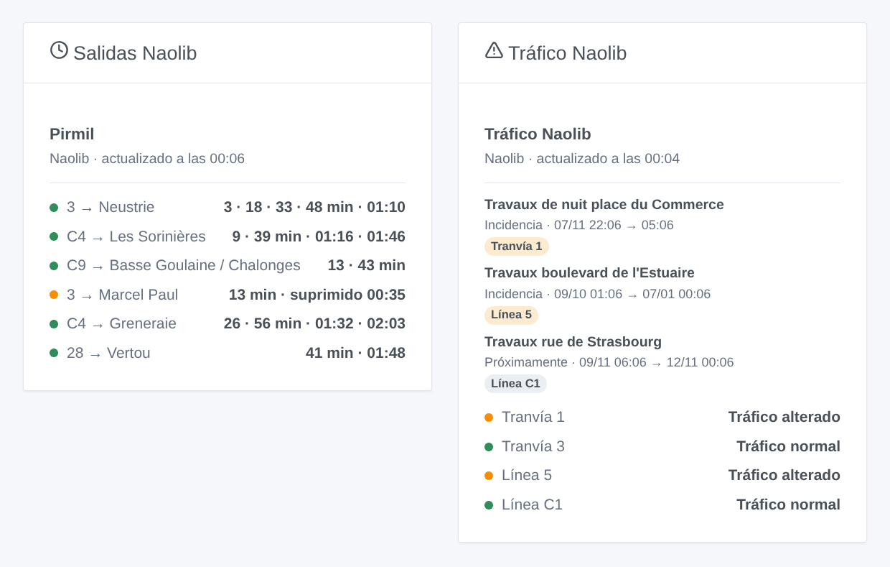

# Naolib Nantes

## Presentación

Esta integración lleva **Naolib**, los tranvías, busways, Chronobus, autobuses y Navibus de Nantes Métropole, a Gladys. Da las **próximas salidas, corregidas en tiempo real, con su retraso**, en las paradas que elijas (tres en el formulario, hasta 10 más con un botón), filtradas por línea y dirección. También sigue el **tráfico** de hasta seis líneas (normal, aviso de tráfico, alterado, muy alterado), con las **alertas** de Naolib: desvíos, paradas trasladadas, obras. Cada parada y cada línea se convierte en un dispositivo para mostrar en un panel y usar en escenas.

Los datos proceden de los **datos abiertos oficiales de Naolib** (Nantes Métropole), con licencia ODbL: sin cuenta ni clave. El **horario** (GTFS, publicado en `data.nantesmetropole.fr`) solo se descarga cuando se publica un archivo nuevo, y la integración lo conserva. El **tiempo real** (GTFS-RT) de toda la red se lee a través de `transport.data.gouv.fr`, el punto de acceso nacional, en **una sola petición para todas las paradas seguidas**, cada minuto por defecto (cada 10 minutos mientras ninguna parada anuncie nada en la próxima media hora, de noche). Las alertas se leen cada 5 minutos.

Una salida se **sigue en tiempo real** en cuanto su viaje está en curso: se dan su hora estimada y su retraso. Antes es el **horario teórico**, marcado «(teórico)». Se indican los **viajes suprimidos** y las **paradas sin servicio**.

La fuente del tiempo real solo responde una vez cada 30 segundos para todos: cuando está ocupada, la integración vuelve a preguntar unos segundos después y, mientras tanto, usa su última lectura (de menos de 3 minutos).

Es una integración **cloud**: contacta con `data.nantesmetropole.fr` y `proxy.transport.data.gouv.fr`. Nada más sale de tu red.

## Requisitos

- Gladys Assistant 5.3.0 o posterior.
- Nada más: los datos abiertos de Naolib no piden cuenta ni clave.

## Configuración

| Campo                   | Qué escribir                                                                                                            |
| ----------------------- | ----------------------------------------------------------------------------------------------------------------------- |
| Parada 1, 2, 3          | El nombre de la parada tal como aparece en ella: «Commerce», «Gare Nord - Jardin des Plantes».                          |
| Línea                   | Solo esta línea: «1», «C1», «4», «N1». Vacío: todas las líneas de la parada.                                            |
| Dirección               | Solo los destinos que contienen estas palabras: «Beaujoire», «Beaujoire \| Ranzay». Vacío: ambos sentidos.              |
| Líneas seguidas         | Las líneas cuyo tráfico sigues, seis como máximo: «1, 2, C1, 4».                                                        |
| Lectura del tiempo real | Cada 30 segundos, minuto, 2 minutos o 5 minutos.                                                                        |
| Idioma de los textos    | Nombres de los dispositivos, resúmenes y salidas de las escenas. Los nombres de paradas y los avisos quedan en francés. |

Una parada reúne todos los andenes de su zona de parada, tranvías y autobuses: «Commerce» da ambos sentidos de los tranvías 1, 2 y 3 y los autobuses que pasan por ella. Un nombre presente en dos municipios («Poitou») da dos paradas: **Buscar una parada** escribe la segunda con «-2». El botón **Buscar una parada** da las paradas que contienen unas palabras, con sus líneas («Commerce → 1, 2, 3…»). Bastan unas palabras cuando una sola parada las contiene («haluch» → Haluchère - Batignolles). **Probar la conexión** vuelve a pedir el horario y lee al momento cada parada y cada línea.

Una línea se escribe como en el vehículo: «1» a «3» para los tranvías, «4» y «5» para los busways, «C1» a «C20» para los Chronobus, «N1» a «N3» para los Navibus, «26», «NS» (Nuit Sud)…

Más paradas que las tres del formulario (casa, trabajo, colegio…): **Añadir una parada** toma los mismos tres campos — parada, línea, dirección — y sigue hasta 10 paradas más. **Listar las paradas** muestra todas las paradas seguidas, numeradas; **Quitar una parada** toma ese número (o el nombre). Las paradas añadidas se guardan en la configuración de Gladys, así que siguen sus copias de seguridad.

El horario de Naolib es un archivo grande: la primera lectura, y la de cada archivo nuevo, tarda unos 20 segundos.

## Uso

### Dispositivos

En la pestaña **Descubrir**, crea los dispositivos que quieras:

- **Naolib \<parada\>**: la próxima salida en texto («1 → Beaujoire · 3 min (+2 min de retraso)»), la espera de la próxima salida y de la siguiente (minutos), y el retraso de la próxima (minutos, publicado solo cuando se sigue en tiempo real);
- **Naolib tranvía 1**, **Naolib línea C1**…: el tráfico en texto («Tráfico alterado: Travaux boulevard de l'Estuaire») y el número de avisos de tráfico en curso.

De noche, sin salidas en las próximas tres horas, el dispositivo muestra la primera salida de la mañana.

### Tráfico

Naolib publica **alertas**: un texto, las líneas (o las paradas) afectadas y sus periodos. El estado de una línea viene de su alerta en curso más grave: **muy alterado** para una interrupción, **alterado** para un desvío, paradas trasladadas o sin servicio, retrasos, **aviso de tráfico** en los demás casos; **normal** sin alerta. Una alerta que empieza en los próximos tres días se muestra como próxima. El enlace al plano de un desvío, cuando existe, se abre desde la tarjeta de la alerta.

### Widgets del panel

- **Salidas Naolib**: las próximas salidas de una parada, en compacto. Una fila por línea y destino, con sus próximas salidas seguidas («2 · 17 min»). Un viaje suprimido se indica («suprimido 22:48») y pone la fila en naranja, como un retraso de 5 minutos o más. El ajuste **Trayectos mostrados** fija el número de filas. Elige una parada seguida, o escribe cualquier parada (y una línea) en los ajustes del widget. Con **Varias paradas**, un solo widget muestra varios dispositivos de parada: los dispositivos de una misma parada se fusionan bajo su nombre; para paradas distintas, cada parada empieza con una fila propia.
- **Tráfico Naolib**: el estado de cada línea, luego las alertas en curso y las de los próximos tres días, con su periodo. Toca una tarjeta para ver el texto completo. Las líneas seguidas, las escritas en los ajustes, o las tres líneas de tranvía si no sigues ninguna.

### Escenas

Disparadores, una vez por cambio (la primera lectura solo sirve de referencia):

- **Naolib: salida en breve**: una salida de una parada seguida sale dentro de 2, 3, 5, 10, 15 o 20 minutos, contados sobre su estimación en tiempo real.
- **Naolib: salida suprimida**: un viaje de la próxima hora en una parada seguida se suprime, o no para en la parada.
- **Naolib: línea alterada**: una línea seguida pasa a alterada o muy alterada.
- **Naolib: fin de la incidencia**: ya no hay ninguna alteración en curso en la línea.
- **Naolib: nuevo aviso de tráfico**: Naolib publica una alerta sobre una línea seguida, en curso o próxima.

Cada uno da una frase lista, `{{triggerEvent.data.summary}}`, y sus valores (línea, destino, hora, retraso, título, texto, inicio y fin…). Las acciones **Naolib: próximas salidas** y **Naolib: tráfico de una línea** devuelven el mismo tipo de valores, para ponerlos en un mensaje o comprobarlos en una condición.

Ejemplos:

- Cuando el tranvía 1 hacia Beaujoire sale de Commerce dentro de 5 minutos → poner en verde la lámpara de la entrada.
- Cuando una salida de tu parada se suprime, o el C1 se desvía → enviar el resumen a tu teléfono antes de salir.
- Cada día laborable a las 7:30 → leer las próximas salidas de tu parada y hacer que el altavoz de la cocina las anuncie.

### Transporte

Solo cloud: los datos vienen de internet. El horario cuando se publica un archivo nuevo, el tiempo real de toda la red en una petición, las alertas cada 5 minutos.

## Solución de problemas

- **«Desconocido o ambiguo»**: usa **Buscar una parada** y copia el nombre exacto (con su «-2» para la segunda parada de un nombre); para una línea, su nombre como en el vehículo («1», «C1», «4»).
- **«(teórico)» tras una salida**: su viaje aún no está en curso, o Naolib no lo sigue; la hora es la del horario.
- **Ninguna salida en la dirección escrita**: los destinos son los que muestran los vehículos («Beaujoire», «François Mitterrand»); vacía la dirección para verlos todos.
- **«Los datos abiertos de Naolib no responden»**: la integración lo reintenta en cada lectura; mientras tanto, las salidas vienen del horario guardado. Un rechazo breve del tiempo real (su fuente solo responde una vez cada 30 segundos) pasa desapercibido: se usa la última lectura.
- **Para informar de un problema**: pulsa **Diagnóstico** y copia las líneas que empiezan por «Naolib diagnostic» de la pestaña Registros en un issue de GitHub o una respuesta en el foro, con las versiones de Gladys y de la integración.
